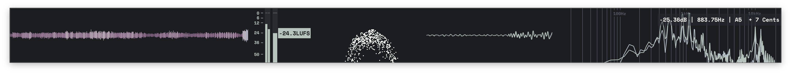
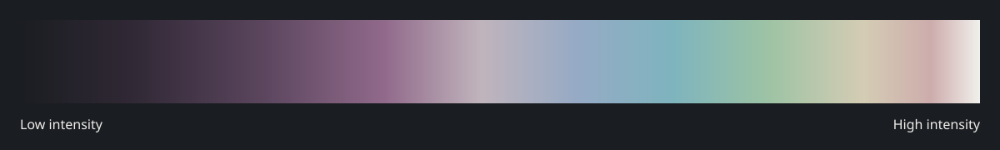

# Compline for MiniMeters

A [MiniMeters](https://minimeters.app/) theme and spectrogram color map based on [Compline](https://github.com/jblais493/compline) by Joshua Blais. The interface uses Compline's muted dark palette. The color map adds plum, blue, teal, sage, gold, and rose to make the spectrogram easier to read without leaving that palette's feel.

### Spectrogram color map

The color map preview shows the stops in `Compline.map`. The app screenshot shows the theme with the spectrogram disabled, so it does not show the color map in use.

## Install

1. Copy `Compline.ini` to `~/Library/Preferences/MiniMeters/Themes/` on macOS.
2. Copy `Compline.map` to `~/Library/Preferences/MiniMeters/colormaps/`.
3. Restart MiniMeters if **Compline** does not appear in its theme or color map menus. Select **Compline** in both menus. The color map applies to the spectrogram; enable that module to see it.

The theme and color map can be used independently.

## Credit

The palette is adapted from [Compline](https://github.com/jblais493/compline) by Joshua Blais (GPL-3.0). This MiniMeters adaptation is distributed under GPL-3.0; see [LICENSE](LICENSE).
